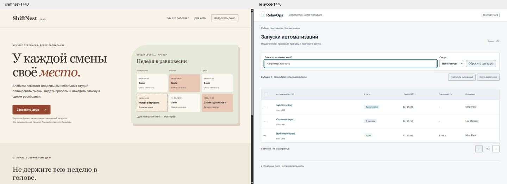

# UI-проверка — 3–4 ноября 2026 года

Проверены README, архитектура и изменения PR #1 на `85894ef654580de239dd4a860f3a3b15db9adf64`. Исходный CI run `41714598844` успешен. Дерево локального `c1d391d` совпало с удалённым: `885432c47eb755126b5a9c3381912c245d4a2cac`.

Среда: текущая сессия Codex (точная модель и build не зафиксированы), Windows, встроенный браузер приложения через CUA, Python 3.12, Node 24.19.0. Два отдельных HTML/CSS/JS-проекта с девятью установленными Skills и routing-rule. Без сторонних UI-библиотек, backend и сетевой отправки форм. Исходники результатов: [examples/ui](../examples/ui/README.md).

## Что подтвердилось

| Проверка | ShiftNest | RelayOps |
|---|---|---|
| Главный путь | CTA → форма → локальный результат | Поиск run-1042 → причина сбоя → повтор → новый queued ID |
| Ошибка и восстановление | Invalid email, связанная ошибка и фокус; введённые значения сохранены после отказа; успешный retry | Отказ сохраняет исходный failed; медленный двойной клик создаёт одну новую запись |
| Состояния | Pending, failure, success | Начальная загрузка, пустой workspace, no results, load error/retry, read-only |
| Выделение | Не применимо | Сохраняется между страницами; сбрасывается с пояснением при смене фильтра; после частичного отказа повторяется только неудачный ID |
| Навигация и клавиатура | Enter открывает CTA; Escape закрывает форму и меню; фокус возвращается | Клавиатурная сортировка/выделение, возврат фильтра и фокуса, Tab/Shift+Tab в деталях, прямой URL и reload |
| Узкие экраны | 320/390/768/1440 CSS px без переполнения страницы | Те же размеры; длинное название и лог в мобильных деталях; null duration отображается как «—» |
| Текст 200% | Проверен через harness на 768 и 320 px; исправлены переполнение навигации, иллюстрации и формы | Проверен через harness на 768 и 320 px |
| Права и пагинация | Не применимо | Read-only блокирует UI; mock повторно проверяет права после задержки; удаление последней записи корректирует страницу |

Контраст основных пар рассчитан по sRGB: основной/приглушённый текст ShiftNest 12.23/5.95, CTA 6.71; RelayOps 12.76/5.76, CTA 7.20; подписи статусов 6.10–6.86. Граница полей RelayOps исправлена с 2.46 до 3.57 относительно белого фона. Это выборочные проверки, не полный аудит всех состояний.

Снимки просмотрены визуально. Различаются композиция, типографика, плотность, форма и поверхности: у ShiftNest редакционный serif, кремовая палитра и иллюстрация расписания; у RelayOps компактная таблица, utilitarian sans, табличные числа, холодные нейтрали и минимум декора. Отличие не ограничивается цветом. Ни маркетингового hero в приложении, ни вымышленных отзывов/цен на лендинге нет.

## Найдено и исправлено

1. Прямой вход в детали: без предыдущего списка `history.back()` уходил в `about:blank`. В демо добавлен возврат в список с сохранённым запросом; в web-app-design — явное правило и проверка direct URL/reload.
2. При увеличении текста навигация и элементы ShiftNest выходили за экран, хотя стандартные viewport-проверки проходили. Исправлены переносы и минимальные размеры; в verification добавлена отдельная проверка text resize с указанием метода.
3. Слишком светлые границы полей RelayOps: усилен контраст. Существующее правило core уже покрывает этот случай, поэтому ещё одно правило не добавлялось.
4. Нативный dialog после последнего элемента отпускал фокус из документа. В RelayOps добавлен явный цикл Tab/Shift+Tab и проверен повторно. Основной путь не был заблокирован.

Промежуточные неудачи сохранены в [журнале](../examples/ui/qa-results.json), последующие проверки фиксируют исправления. Финальный цикл фокуса подтверждён после завершения начальной загрузки; ранние попытки `*-fixed` не прошли, успешные записи имеют суффикс `*-final`. В журнале браузерного инструмента также была ошибка MutationObserver без URL источника; в коде демо MutationObserver отсутствует, происхождение ошибки не установлено. Проверка «нет ошибок браузера» не засчитывается. Журнал не следует интерпретировать как независимый benchmark или счётчик unit-тестов.

## Роутинг и архитектура

В этом сопровождаемом прогоне применены `core + landing` и `core + web-app + data-table`. Простая трёхполевая форма покрыта core/landing; forms был просмотрен при ревью набора, но не требовался для отдельного многошагового процесса. Статический лог не активирует monitoring, read-only не требует admin, счётчики не требуют dashboard. При ревью обнаружены явные границы для backend-only, локальной правки формы, существующего бренда и Figma.

Циклов router → specialist → router нет; core и references имеют общую ответственность, специализации добавляют предметные решения. Установщик и ссылки проверены. Условия MIT и исходные credits сохранены. Существенная перестройка архитектуры по результатам этого прогона не нужна.

**Автоматическое обнаружение не подтверждено:** этот агент заранее прочитал роутер и оценочную матрицу. Это проверка применения инструкций, не слепой тест выбора. Свежие сессии Codex, Claude Code и Cursor не запускались. В evaluation уточнено различие между установкой, явным применением и автоматическим обнаружением; следующий шаг — отдельные слепые прогоны без подсказки ожидаемого маршрута, с фиксацией модели/версии и routing-rule.

## Рубрика после исправлений

| Измерение | ShiftNest | RelayOps |
|---|---:|---:|
| Задача и иерархия | 2 | 2 |
| Состояния и восстановление | 2 | 2 |
| Доступность | 1 | 1 |
| Адаптивность | 2 | 2 |
| Визуальное соответствие | 2 | 2 |
| Реализация | 2 | 2 |
| **Итого** | **11/12** | **11/12** |

Оценка 1 за доступность учитывает ограничения: текст увеличивался через harness, а не нативную настройку браузера; screen reader, forced colors и полный набор контрастов не проверены. На 320 px при 200% длинные слова переносятся внутри слова; контент и действия доступны, но это компромисс плотности. В демо нет движущихся эффектов; CSS содержит reduced-motion guard, однако переключение системного prefers-reduced-motion не выполнялось. Конверсия, нагрузка, реальный touch-device и production API также не проверены.

## Проверки репозитория

- 27 Python-тестов пройдены без пропусков; 10 Skills и bundle-ссылки валидны.
- JS обоих примеров прошёл `node --check`; данные `fixture.js` сверены с исходным JSON.
- Проверен `git diff --check`. UI-примеры используют только локальные операции.
- Начальный запуск Python потребовал рабочего TEMP и доступного PyYAML; это настройка окружения, не изменение тестов.

Результат: основные UI-сценарии воспроизведены и исправлены. Готовность автовыбора во всех трёх агентах и production-готовность этим отчётом не заявляются. PR остаётся черновиком; main не изменяется.
